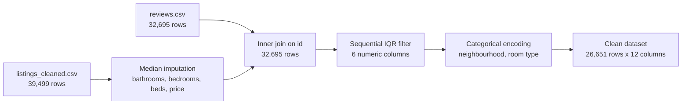

<div align="center">

# 🏠 Organizing and Analyzing Airbnb Data: Rio de Janeiro

**A complete data-cleaning pipeline that turns raw Airbnb listings and reviews into an analysis-ready dataset**


[](https://colab.research.google.com/github/Laurentius96/Organizing_and_analyzing_Airbnb_data/blob/main/main.ipynb)

<p>
  <a href="#-overview">Overview</a> •
  <a href="#-dataset">Dataset</a> •
  <a href="#-data-pipeline">Pipeline</a> •
  <a href="#-results">Results</a> •
  <a href="#-key-insights">Insights</a> •
  <a href="#-design-decisions-and-limitations">Decisions</a> •
  <a href="#-how-to-use">How to Use</a> •
  <a href="#-contributing">Contributing</a> •
  <a href="#-license">License</a>
</p>

</div>

---

## 🔍 Overview

Raw marketplace data is messy: missing prices, impossible capacities, extreme values and text categories that models cannot read. This project builds a **reproducible cleaning pipeline** for Airbnb data from **Rio de Janeiro**, covering data integration, missing-value imputation, outlier removal with the IQR method and categorical encoding.

| | Rows |
|---|---:|
| 🏠 Raw listings | 39,499 |
| ⭐ Listings with reviews | 32,695 |
| 🔗 Merged dataset (after imputation) | 32,695 |
| ✅ **Clean, analysis-ready dataset** | **26,651** |

> Built as a data-cleaning challenge of the DNC School Data Science program, using public data from [Inside Airbnb](http://insideairbnb.com/).

## 🎯 Objective

1. **Integrate** the listings and reviews datasets
2. **Measure and impute** missing values with a strategy suited to each column
3. **Detect and remove** extreme values with a transparent statistical rule
4. **Encode** categorical variables so the data is ready for modeling

## 📊 Dataset

Both files live in [`data/`](data):

| File | Rows | Description |
|---|---:|---|
| `listings_cleaned.csv` | 39,499 | One row per listing |
| `reviews.csv` | 32,695 | Review count and score per listing |

<details>
<summary><b>📖 Data dictionary</b></summary>
<br>

| Column | Source | Type | Description |
|---|---|---|---|
| `id` | both | int | Listing identifier (join key) |
| `neighbourhood_cleansed` | listings | category | Neighbourhood of the listing |
| `room_type` | listings | category | Entire home/apt, Private room, Shared room or Hotel room |
| `accommodates` | listings | int | Maximum number of guests |
| `bathrooms` | listings | float | Number of bathrooms |
| `bedrooms` | listings | float | Number of bedrooms |
| `beds` | listings | float | Number of beds |
| `price` | listings | float | Nightly price (R$) |
| `number_of_reviews` | reviews | int | Total reviews received |
| `review_scores_rating` | reviews | float | Average review score (0–5) |
| `neighbourhood_code` | created | int | Numeric code of `neighbourhood_cleansed` (0–146) |
| `room_type_code` | created | int | Numeric code of `room_type` (0–3) |

</details>

## 🔄 Data Pipeline



## 📈 Results

### 1️⃣ Missing values

Only the listings file has missing values; the reviews file is complete.

| Column | Missing | % of listings | Imputed with median |
|---|---:|---:|---:|
| `bathrooms` | 2,890 | 7.32% | 1.0 |
| `beds` | 2,869 | 7.26% | 2.0 |
| `price` | 2,855 | 7.23% | R$ 728.00 |
| `bedrooms` | 523 | 1.32% | 1.0 |

### 2️⃣ Outliers (IQR method)

Outliers flagged on the merged dataset (32,695 rows) with `Q1 − 1.5 × IQR` and `Q3 + 1.5 × IQR`:

| Column | Lower bound | Upper bound | Outliers | % |
|---|---:|---:|---:|---:|
| `accommodates` | −1.0 | 7.0 | 1,356 | 4.15% |
| `bathrooms` | −0.5 | 3.5 | 398 | 1.22% |
| `bedrooms` | −0.5 | 3.5 | 485 | 1.48% |
| `beds` | −2.0 | 6.0 | 501 | 1.53% |
| `price` | −589.0 | 2,011.0 | 923 | 2.82% |
| `number_of_reviews` | −36.5 | 63.5 | 3,637 | 11.12% |

Removal is **sequential**: bounds are recomputed on the rows left after each column is filtered.

| After filtering | Rows left |
|---|---:|
| `accommodates` | 31,339 |
| `bathrooms` | 31,154 |
| `bedrooms` | 31,046 |
| `beds` | 30,930 |
| `price` (bounds −552.50 to 1,931.50) | 29,820 |
| `number_of_reviews` | **26,651** |

**Result:** 6,044 rows removed (**18.49%**), 26,651 kept (**81.51%**).

### 3️⃣ Categorical encoding

| Variable | Categories | New column |
|---|---:|---|
| `neighbourhood_cleansed` | 147 | `neighbourhood_code` (0–146) |
| `room_type` | 4 | `room_type_code` (0–3) |

`room_type` mapping: `0` Entire home/apt (20,639) · `1` Hotel room (10) · `2` Private room (5,844) · `3` Shared room (158).

## 💡 Key Insights

| Topic | Finding |
|---|---|
| 📍 Concentration | **Copacabana** holds **30.5%** of all listings; the top 5 neighbourhoods hold **57.4%** |
| 🏘️ Top 5 neighbourhoods | Copacabana (8,131) · Barra da Tijuca (2,403) · Ipanema (1,886) · Recreio dos Bandeirantes (1,462) · Jacarepaguá (1,424) |
| 🏠 Room types | Entire home/apt **77.4%** · Private room **21.9%** · Shared and hotel rooms under 1% |
| 💰 Price | Median **R$ 617** · mean **R$ 700.56** (still right-skewed after cleaning) |
| ⭐ Reviews | Average score **4.81 / 5** |

## 🧭 Design Decisions and Limitations

- **Median imputation:** `bathrooms`, `bedrooms` and `beds` are discrete and `price` is heavily right-skewed, so the median is more robust than the mean.
- **Merge after imputation, inner join:** imputing first preserves the full listings distribution; the inner join keeps only listings with review data.
- **`review_scores_rating` kept out of the IQR filter:** it lives on a bounded 0–5 scale.
- **Sequential IQR filtering** is stricter than flagging all columns at once and removed 18.49% of the rows.
- ⚠️ **Popularity bias:** the `number_of_reviews` filter alone flags 11.1% of the rows, removing the most-reviewed listings. Analyses about popularity should use the merged dataset before outlier removal.
- ⚠️ **Label encoding is nominal:** codes follow alphabetical order and carry no ranking. Tree-based models handle them well; linear models should use one-hot encoding.

## 📁 Project Structure

```
📁 Organizing_and_analyzing_Airbnb_data/
├── 📁 data/
│   ├── 📄 listings_cleaned.csv    # Listings (39,499 rows, 8 columns)
│   └── 📄 reviews.csv             # Reviews (32,695 rows, 3 columns)
├── 📓 main.ipynb                  # Full pipeline with outputs and charts
├── 📄 requirements.txt            # Python dependencies
├── 📄 LICENSE.md                  # CC BY-NC-ND 4.0
└── 📄 README.md                   # This file
```

## 🚀 How to Use

1. **Clone the repository**

   ```bash
   git clone https://github.com/Laurentius96/Organizing_and_analyzing_Airbnb_data.git
   cd Organizing_and_analyzing_Airbnb_data
   ```

2. **Install the dependencies**

   ```bash
   pip install -r requirements.txt
   ```

3. **Run the notebook**

   ```bash
   jupyter notebook main.ipynb
   ```

> 💡 **In Google Colab:** click the *Open In Colab* badge, then run this in the first cell so the notebook finds the `data/` folder:
>
> ```python
> !git clone https://github.com/Laurentius96/Organizing_and_analyzing_Airbnb_data.git
> %cd Organizing_and_analyzing_Airbnb_data
> ```

## 🔭 Next Steps

- [ ] Price analysis by neighbourhood and room type with statistical tests
- [ ] Compare outlier strategies (IQR vs. capping vs. log transform) and their effect on the price distribution
- [ ] Price-prediction model using the encoded features
- [ ] Interactive map of listings and prices by neighbourhood

## 🤝 Contributing

Contributions, ideas and feedback are welcome!

- 🐛 **Found a bug or something unclear?** [Open an issue](https://github.com/Laurentius96/Organizing_and_analyzing_Airbnb_data/issues/new) describing what happened and how to reproduce it.
- 💡 **Have an idea or a question?** [Open an issue](https://github.com/Laurentius96/Organizing_and_analyzing_Airbnb_data/issues/new) and tell me about it.
- 🔧 **Want to propose a fix?** Fork the repository, create a branch (`git checkout -b fix/short-description`), commit your changes and open a pull request explaining what changed and why.

By contributing, you agree that your contribution is shared under the same license as this project.

## 📜 License

This project is licensed under the [Creative Commons Attribution-NonCommercial-NoDerivatives 4.0 International License (CC BY-NC-ND 4.0)](LICENSE.md).

**What this means:**
- ✅ You may **share** this work with **attribution**
- ❌ You may **not** use it for **commercial purposes**
- ❌ You may **not** distribute **modified versions**

## 🙏 Acknowledgments

- [DNC School](https://www.escoladnc.com.br/) for the challenge framework
- [Inside Airbnb](http://insideairbnb.com/) for making the data publicly available

---

<div align="center">

**Lorenzo C. Bianchi** · [GitHub](https://github.com/Laurentius96) · [LinkedIn](https://www.linkedin.com/in/cb-lorenzo/)

</div>
